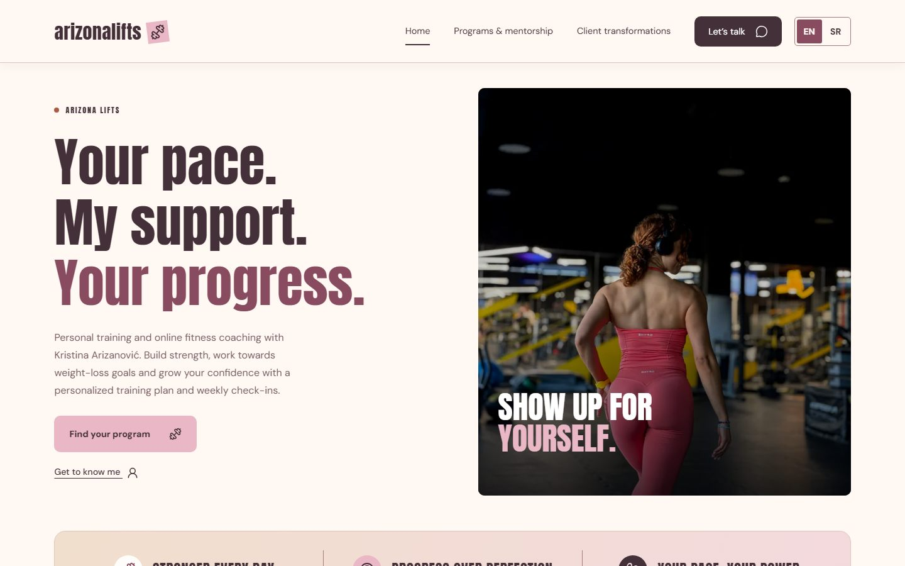

# ARIZONALIFTS — fitness coach website

> **⚠️ View only — not open source.**
> This code is public for viewing only. Copying, modifying, deploying, redistributing or reusing any part of it (code, design, texts or branding), or using it to train AI models, is not allowed without written permission. See [LICENSE](LICENSE).

**Live site:** https://arizonalifts.com

Website for personal trainer Kristina Arizanović (ARIZONALIFTS), built, hosted and maintained by Miloš Milinkov.



## What's inside

- **One long, mobile-first page** for Home, Programs & mentorship and Client transformations, with the navigation highlighting the section in view.
- **English and Serbian** (Latin script) with real, crawlable URLs per language, `hreflang` tags and an accessible language switcher.
- **Latest Instagram and TikTok posts** as self-hosted covers. The embed loads only on click, so there are no third-party requests, cookies or layout shift on page load.
- **SEO and link previews:** per-page titles, descriptions and canonical URLs, Open Graph tags, JSON-LD (WebSite + Person), and a generated sitemap and robots.txt.
- **Optimised images** throughout, plus tests for locale key parity, content, images, SEO and the social feed.

## Stack

Vue 3 · Vue Router · Vue I18n · Vite · plain CSS with design tokens · `node:test` · hosted on Cloudflare Pages (static, no runtime backend).

## Development

Run in `frontend/`:

```bash
npm install
npm run dev      # Vite dev server on 127.0.0.1:5173
npm test         # locale, content, image, SEO and social feed checks
npm run build    # static build in frontend/dist
```

More detail on content and language rules: [frontend/README.md](frontend/README.md).

## License

Copyright © 2026 Miloš Milinkov. All rights reserved.

This project is proprietary and **not** open source. No licence is granted to use, copy, modify, deploy or distribute it. See [LICENSE](LICENSE) for the full terms. For permission requests, contact milos300399@gmail.com.

Security issues: see [SECURITY.md](SECURITY.md).
